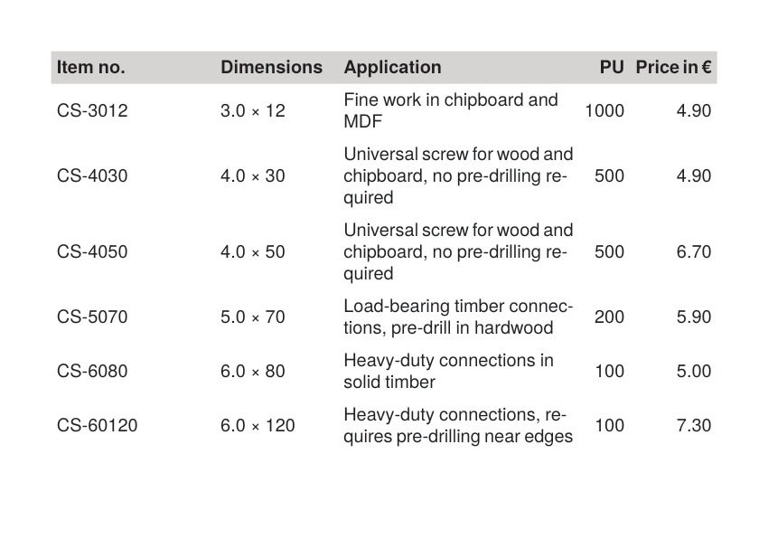

To get the PDF:

Run `sp` on the command line inside this directory.

----

This example shows how to control table column widths: fixed widths for the technical columns, a star width (`1*`) for the application text that takes the remaining space, and alignment set on the column instead of each cell.

It is the running example of the how-to guide [Controlling column widths](https://doc.speedata.de/publisher/en/howto/columnwidths/) in the manual, using the article data of the fictional fastener manufacturer Confixa.

