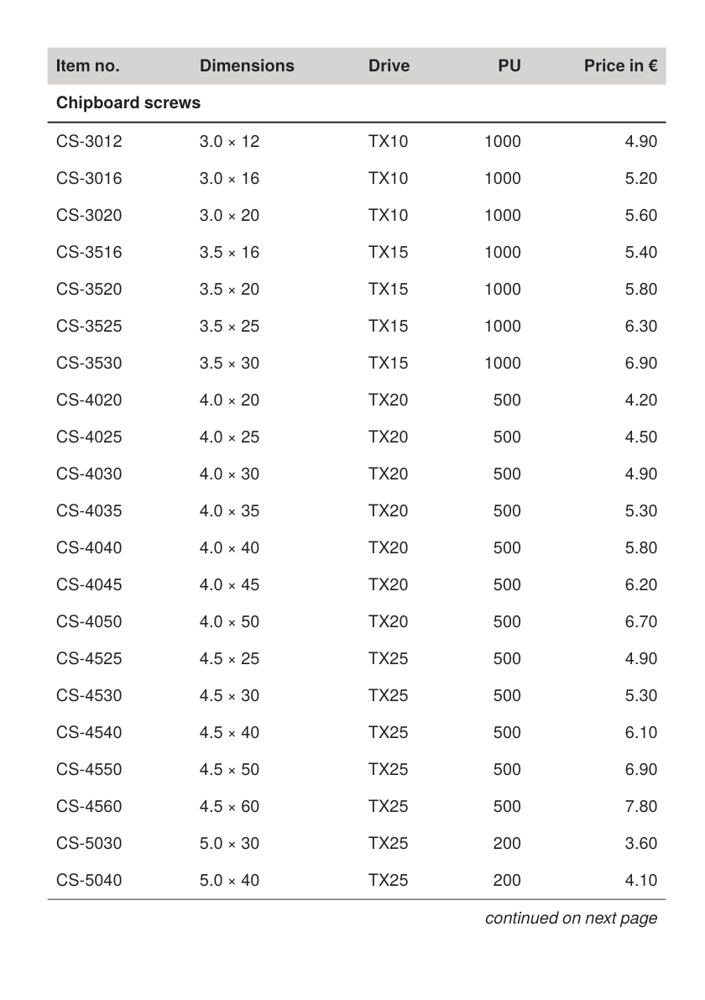

To get the PDF:

Run `sp` on the command line inside this directory.

----

This example shows page-dependent table heads and feet: the first page carries the normal head, the following pages a head with “Continued” (`Tablehead page="first"` / `page="all"`), and the note “continued on next page” appears on every page except the last one (`Tablefoot page="all"` / `page="last"`).

It is the running example of the how-to guide [Continuation head and continuation note](https://doc.speedata.de/publisher/en/howto/continuationhead/) in the manual, using the article data of the fictional fastener manufacturer Confixa.

