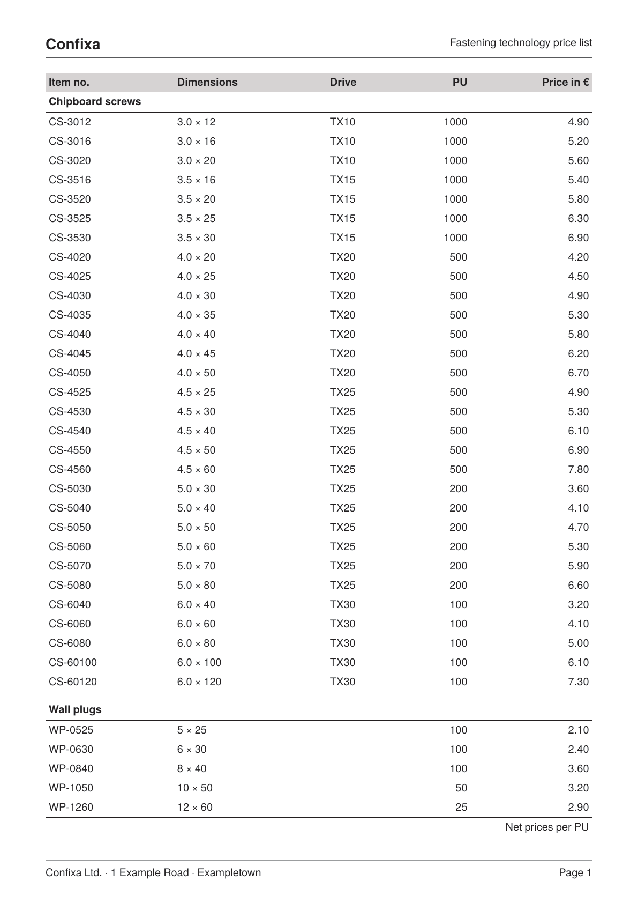

To get the PDF:

Run `sp` on the command line inside this directory.

----

This example shows a reusable page scaffold for data sheets and price lists: a page type with a millimeter-exact head (`AtPageCreation`) and foot with page number (`AtPageShipout`), a fine 3 mm grid and the type area defined as a placement area into which the article table flows and breaks automatically.

It is the running example of the how-to guide [Basic structure of a data sheet](https://doc.speedata.de/publisher/en/howto/datasheet/) in the manual, using the article data of the fictional fastener manufacturer Confixa.

