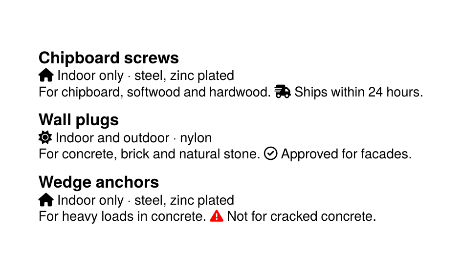

To get the PDF:

Run `sp` on the command line inside this directory.

----

This example shows two ways to use symbols from an icon font (Font Awesome Free): the layout chooses a symbol from a data attribute and switches to the icon font with `Fontface`, and descriptions from a web shop contain Font Awesome markup (`<i class="fa-solid fa-truck-fast"></i>`) that a small stylesheet with `::before` rules turns into symbols.

It is the running example of the how-to guide [Icons from an icon font](https://doc.speedata.de/publisher/en/howto/icons/) in the manual, using the data of the fictional fastener manufacturer Confixa.

The font files in the directory `fonts` are part of Font Awesome Free 6.2.0 by Fonticons, Inc. and are licensed under the SIL Open Font License 1.1, see `fonts/LICENSE.txt`.

