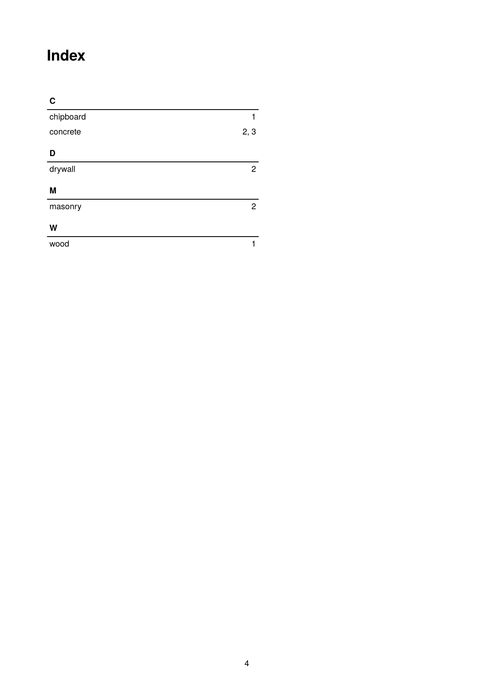

To get the PDF:

Run `sp` on the command line inside this directory. A single run suffices: since the index is placed at the back, all page numbers are already known when it is typeset.

----

This example shows a keyword index built with `<Makeindex>`: while typesetting, each article appends an entry (base material, page number) to a variable; `<Makeindex>` then sorts the entries, groups them by first letter and concatenates the page numbers of identical keywords, and `sd:merge-pagenumbers()` cleans up the page number lists (removing duplicates, merging ranges).

It is the running example of the how-to guide [Keyword index](https://doc.speedata.de/publisher/en/howto/keywordindex/) in the manual, using the article data of the fictional fastener manufacturer Confixa.

