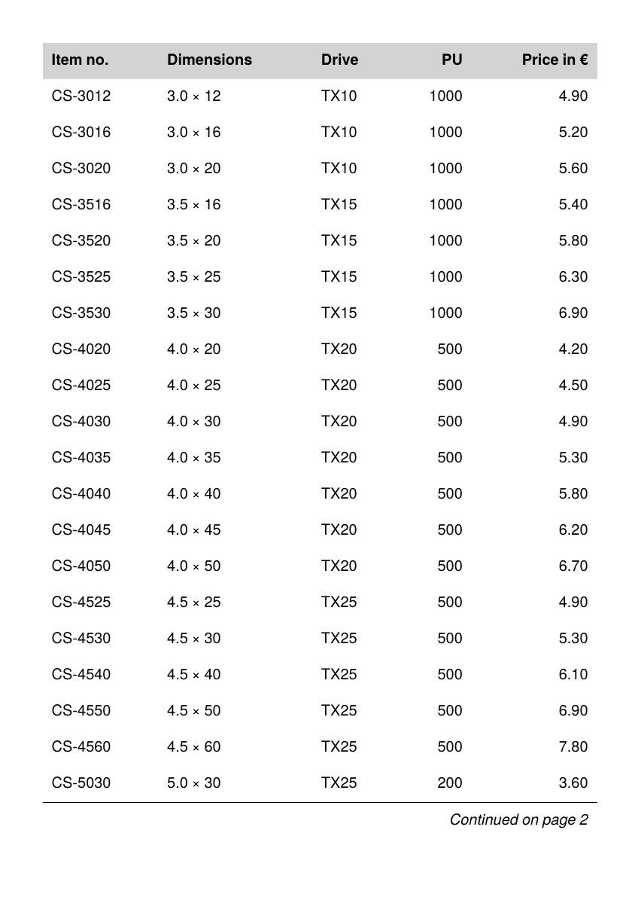

To get the PDF:

Run `sp` on the command line inside this directory.

----

This example breaks a table across pages manually instead of relying on the automatic mechanism: each row is added to a group on a trial basis, `sd:group-height()` is compared with the space remaining on the page, and when a row no longer fits, the portion so far is output as its own table followed by a note “Continued on page X” with the real page number (a `SetVariable` with `execute="later"`, so `sd:current-page() + 1` is evaluated per portion). The first page carries the normal table head, the following pages a head with “Continued”.

It is the running example of the how-to guide [Breaking complex tables manually](https://doc.speedata.de/publisher/en/howto/manualtablebreak/) in the manual, using the article data of the fictional fastener manufacturer Confixa. See also [technical/tablebuilding](../../technical/tablebuilding) for the underlying measure-then-place pattern.

