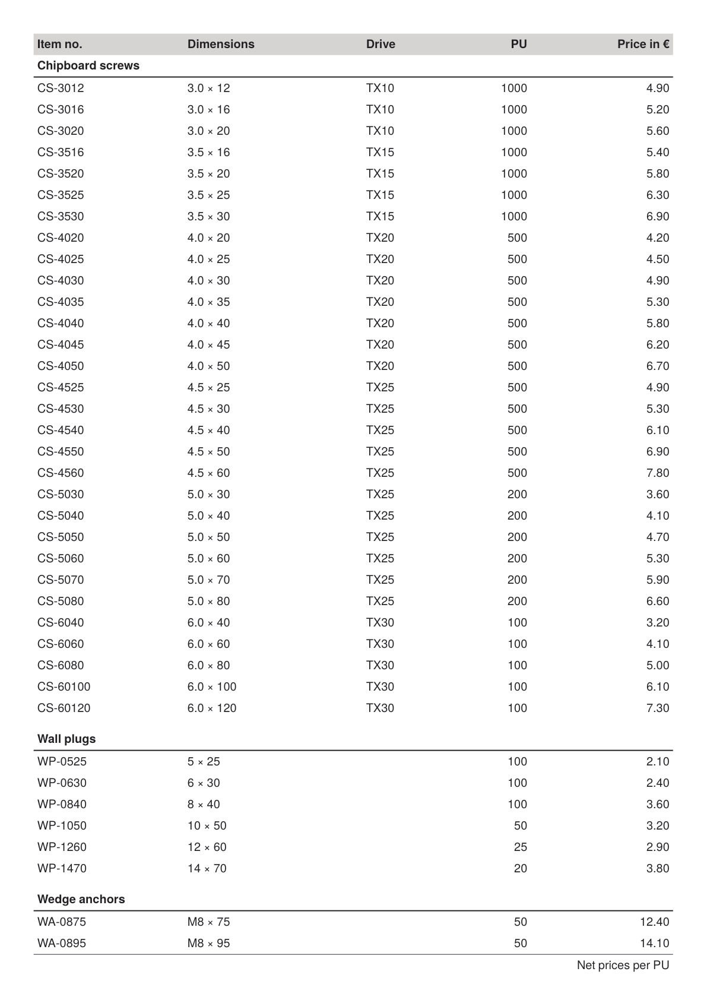

To get the PDF:

Run `sp` on the command line inside this directory.

----

This example shows an article list as a table with automatic page breaking: the Publisher finds the page break itself, the table head and foot repeat on every page.

It is the running example of the how-to guide [Simple table with automatic breaking](https://doc.speedata.de/publisher/en/howto/simpletable/) in the manual. The data belongs to “Confixa”, a fictional manufacturer of fastening technology whose article data is shared by all how-to guides.

