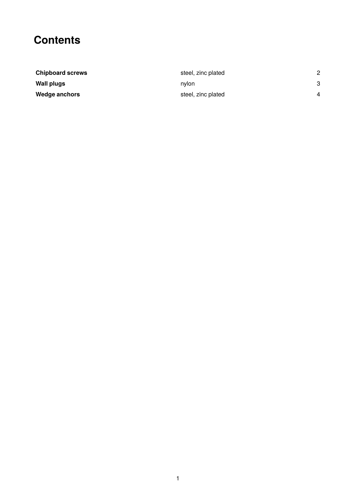

To get the PDF:

Run `sp` on the command line inside this directory. The layout sets `<Options runs="3"/>`, because three runs are needed: the first collects the page numbers, the second adds the table of contents at the front (which shifts everything back by one page), and the third outputs the correct numbers.

----

This example shows a table of contents built with `<SaveDataset>` and `<LoadDataset>`: while typesetting, each article group appends an entry (name, material, page number) to a variable using `<Element>`/`<Attribute>`; the data set is saved at the end of the run and read back at the start of the next one, where it is output as the contents page.

It is the running example of the how-to guide [Table of contents](https://doc.speedata.de/publisher/en/howto/tableofcontents/) in the manual, using the article data of the fictional fastener manufacturer Confixa.

