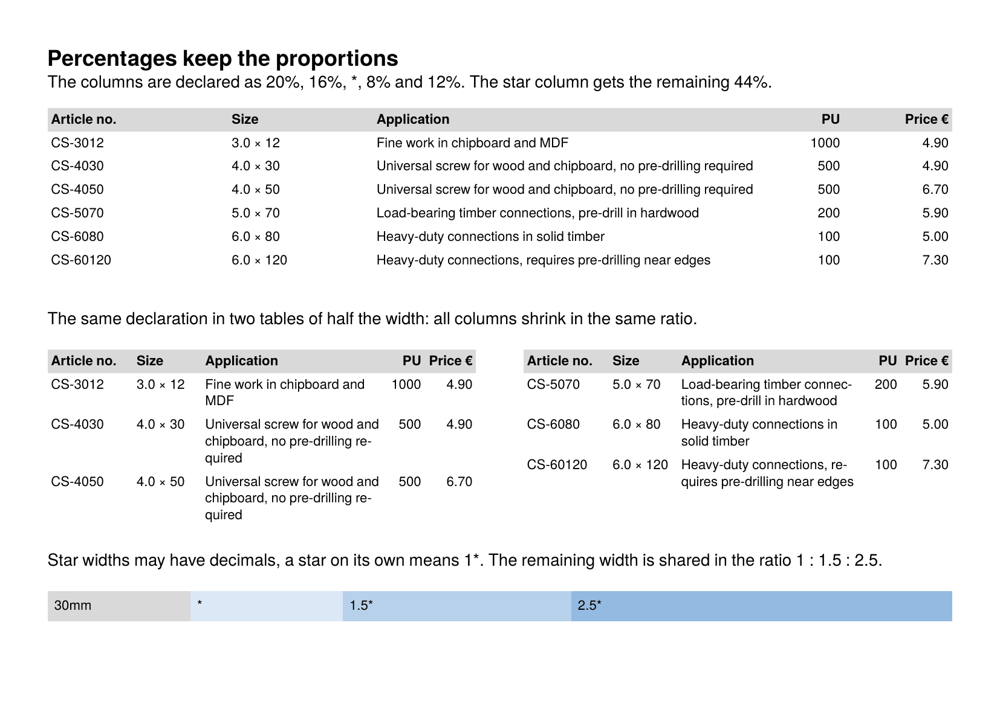

To get the PDF:

Run `sp` on the command line inside this directory. Requires speedata Publisher 5.9.8 or later.

----

The first page shows column widths given as a percentage of the table width (`<Column width="20%"/>`) together with star widths. The same `<Columns>` declaration is used for a table of the full width and for two tables of half the width, so all columns keep their proportions. The last table shows star widths with decimals (`1.5*`) and a single star (`*`, the same as `1*`).

Percentages refer to the table width without the column distances, so columns that add up to 100% fill the table exactly.

The second page shows widths that follow the content:

* `max`: the natural width of the content, never narrower than the widest word,
* `min`: as narrow as the widest word,
* `minwidth`: a lower bound for the width of any column,
* `?`: the natural width of the content; with `stretch="max"` the rest after the fixed columns is shared in the ratio of the natural widths.

See also the how-to [Controlling column widths](https://doc.speedata.de/publisher/en/howto/columnwidths/).

