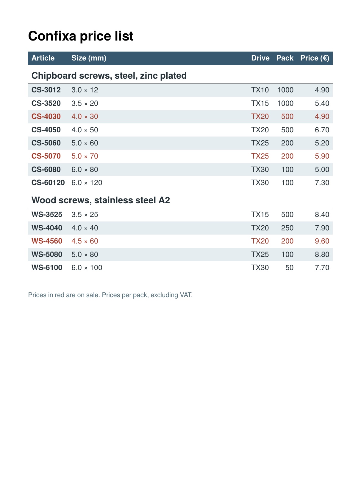

To get the PDF:

Run `sp` on the command line inside this directory. Requires speedata Publisher 5.9.14 or later.

----

A price list where the look of the table comes from CSS. The table commands in the layout only contain the structure (`class="prices"`, `class="group"`); colors, font size, alignment and padding are in the `<Stylesheet>`.

* `table.prices { font-size: 9pt; color: …; padding: 2pt 4pt }` applies to all cells. Font and color are inherited by the paragraphs in the cells, the padding is the default for every cell.
* `tr:nth-child(even)` gives zebra stripes. The rows of the table head are counted on their own, so the stripes in the body do not depend on the head.
* `td:first-child` sets the article number in bold, `td:nth-child(4)` and `td:nth-child(5)` align the numbers to the right.
* The class of a row can come from the data: `class="{if (@sale = 'yes') then 'sale' else ''}"` colors the articles on sale.
* `tr.group` removes the stripe from the group rows. It has the same specificity as the zebra rule and wins because it comes later in the stylesheet.

See also the section [CSS for layout commands](https://doc.speedata.de/publisher/en/manual/webformats/css/#css-layout) in the manual.

