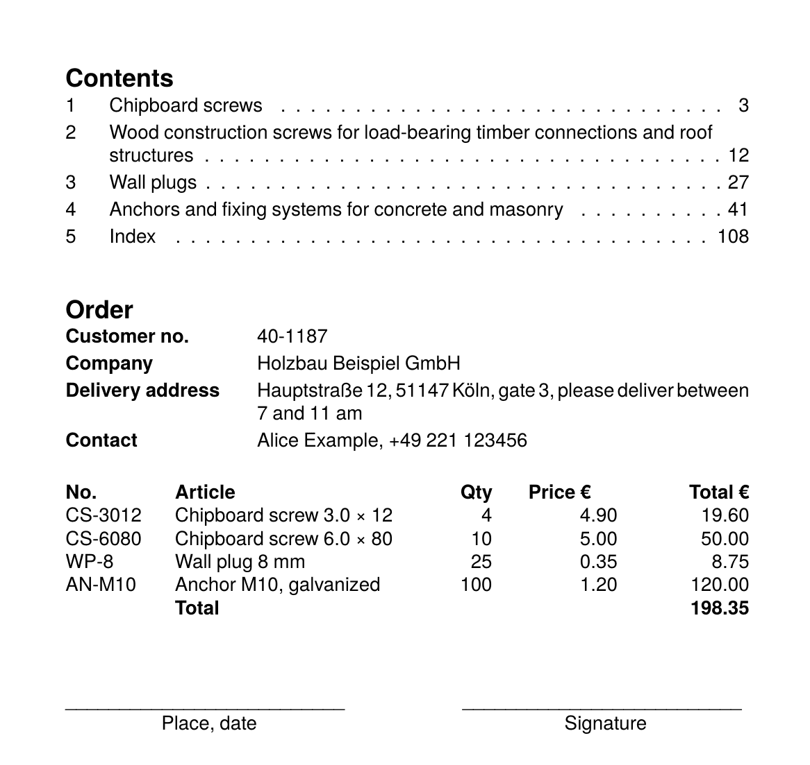

To get the PDF:

Run `sp` on the command line inside this directory. Requires speedata Publisher 5.9.8 or later.

----

This example uses tab stops (`<DefineTextformat tab-stops="...">`) instead of tables:

* a table of contents with dot leaders and page numbers flush right, long titles get a hanging indent (`indentation` and `rows="-1"`),
* a form with labels and values,
* an order list with the quantity right aligned and the amounts aligned on the decimal point,
* signature lines drawn with an underscore leader and captions centered below them.

The data contains no tab characters. The layout inserts them with `concat(@no, '&#9;', @title, '&#9;', @page)` or `<Value>&#9;</Value>`.

See also the manual page [Tab stops](https://doc.speedata.de/publisher/en/manual/text/tabstops/).

